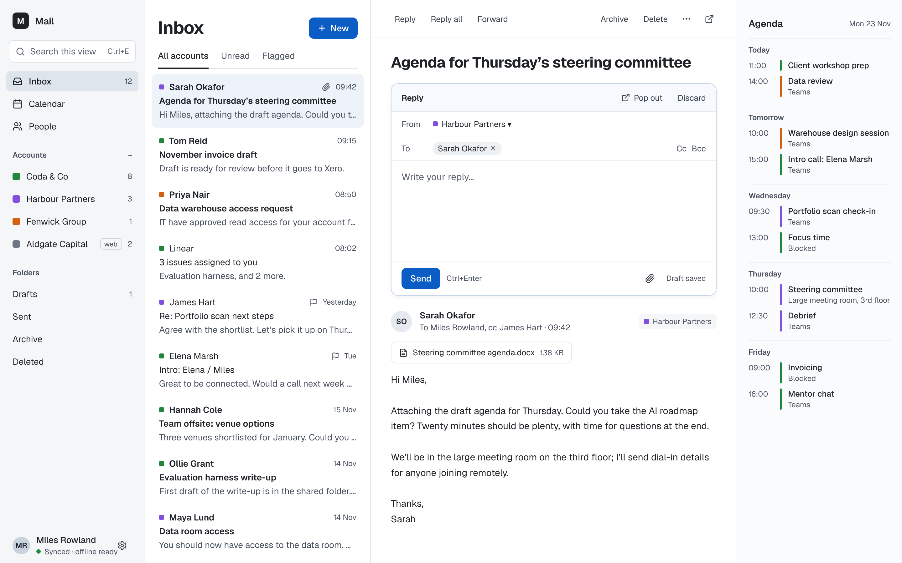

# Mail

A lightweight, fast replacement for Outlook on Windows and macOS: mail, calendar and people for several Microsoft 365 accounts in one window. It works offline, is keyboard first, and gives AI agents draft-only access over a local MCP server.

[SPEC.md](SPEC.md) is the source of truth for behaviour. [design/](design/) holds the mockups and tokens.



## Status against the spec

| Milestone | State |
|---|---|
| 1. Spikes | **Not done; they need the real platforms.** Web view isolation is built (WebView2 user data folder on Windows, WKWebView data store id on macOS 14+, plus the one-window-per-account fallback), but it is untested on Windows and macOS. Graph sign-in and admin consent are built, but untested against real tenants: that needs the app registration ([docs/APP_REGISTRATION.md](docs/APP_REGISTRATION.md)). |
| 2. Read-only mail | Built. Accounts, unified inbox with tabs, folders per scope, reading pane, offline SQLite store, message delta sync, sanitised HTML with remote images shown by default (blocked in Junk, or always when set to ask), attachments on demand. |
| 3. Write mail | Built. Reply at the top of the conversation, compose, pop-out and dock back, outbox (works offline; an unknown send result is held and never repeated), drafts autosaved to the server, archive, delete, flag, rich signatures that swap when From changes. |
| 4. Search and people | Built. FTS5 local index, search filters the current view, facets (From, To, Has attachment, Unread, Date, Account), contact card, "Search the server", people ranked by recency and frequency. |
| 5. Calendar | Built. Day, work week and month views, accounts overlaid and toggleable, event panel with Going / Maybe / No, create and edit, agenda panel, reminders. |
| 6. Web accounts | Built. Outlook on the web in an isolated native web view per account, kept loaded in the background, with unread count and notifications captured from the page. Needs the milestone-1 check on Windows and macOS. |
| 7. MCP server | Built. `mail-mcp` sidecar: search, read message or thread, list events, create and update drafts, create events. Off by default, per account, no sending. |
| 8. Polish | Mostly done. Dark mode, notifications, tray/dock badge, identical shortcuts, CI and signing/update pipeline ([docs/RELEASING.md](docs/RELEASING.md)). Still to do: real certificates, update host, two weeks of daily use. |

## Try it

```bash
pnpm install
pnpm dev             # the interface in a browser, with built-in demo data
```

That runs the React interface against an in-browser demo backend. For the real desktop app with the Rust core:

```bash
MAIL_APP_DEMO=1 pnpm tauri dev    # sample accounts, in memory, no sign-in
pnpm tauri dev                    # real accounts (Coda & Co app registration built in)
```

Debug builds (`pnpm tauri dev`) run as **Mail Dev** with the identifier `co.coda.mail.dev`. That gives them their own data folder, credential-store entries, web-view sign-ins and single-instance lock, so they run beside the installed app without touching its mail. Release builds (`pnpm tauri build`) are **Mail**, `co.coda.mail`.

Prerequisites are Node 22, pnpm 10 (`corepack enable` picks the version pinned in `package.json`), Rust (stable), and on Linux the WebKitGTK development packages (see `.github/workflows/ci.yml`). Linux is for development only.

## Layout

```
src/                  React + TypeScript interface (Vite)
  api/types.ts        The contract between interface and core: every call and event
  api/tauri.ts        Calls into the Rust core (one Tauri command per method)
  api/demo.ts         In-browser demo backend for development and screenshots
src-tauri/            Tauri v2 shell: commands, windows, web-account views, tray, notifications
crates/mail-core/     Everything except the window
  db/                 SQLite: app database + one database per account (FTS5 index)
  service.rs          Local-first operations the interface and MCP server call
  sync.rs             Graph delta sync, pending-operation replay, outbox rules, calendar
  graph.rs, auth.rs   Graph client (immutable ids, Retry-After) and PKCE sign-in
  html.rs             Sanitising, remote-image blocking, signatures, quoting
crates/mail-mcp/      Local MCP server (stdio)
docs/                 Security note for client admins, app registration, releasing, screenshots
```

### How a change flows

1. The interface calls a command.
2. The core applies the change to the local database immediately and queues a pending operation.
3. The sync engine replays the queue against Graph (with retries and backoff), then runs folder and message delta and calendar sync. The inbox is checked every 10 seconds; the full cycle runs every 2 minutes, on window focus, and straight after any action.
4. Change notifications are out of scope for v1 (they need a public endpoint).

Sending is a queued operation like any other, with three rules:

- If the request never reached Graph, it is retried.
- If it may have reached Graph but no answer came back, the draft is **held**. It is resolved automatically once the server copy is gone from Drafts, and otherwise waits for you.
- It is never sent twice.

## Tests

```bash
pnpm typecheck && pnpm test          # interface (vitest)
cargo test --workspace               # core, sync against a mock Graph server, MCP
cargo clippy --workspace --all-targets -- -D warnings
```

## Connecting an agent (MCP)

1. Turn on **Settings → Agents**.
2. Enable the accounts agents may see in **Settings → Accounts**.
3. Paste the snippet shown in the settings panel into your MCP client. It runs the bundled `mail-mcp` with this app's data folder.

Agents can search and read mail, list events, create and update drafts, and create events. They cannot send.

## Open decisions (from the spec)

| Decision | Current state |
|---|---|
| Name | Still "Mail"; the identifier is `co.coda.mail`. |
| Database encryption | Full-disk only; Settings shows whether it is on. SQLCipher would be a `rusqlite` feature switch. |
| Client permission to store mail locally | Check each client's terms before adding them as a Graph account. |
| Ctrl+F | A setting (forward or find); defaults to forward. |
| Who else uses it | Not decided. |
| Minimum macOS version | Set to 14. To be confirmed by the web view spike. |
